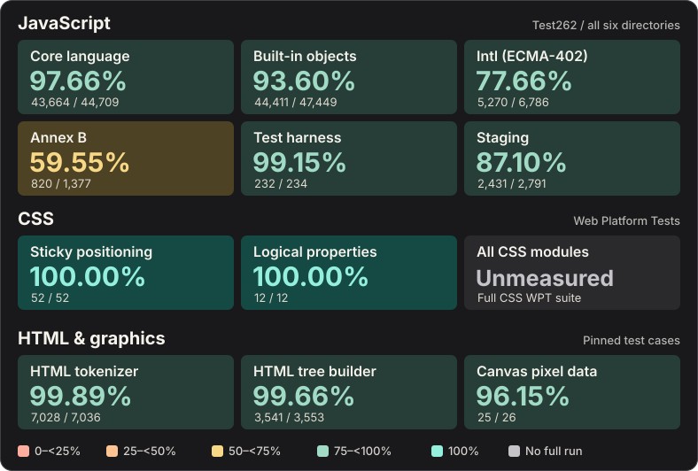

<p align="center"></p>
<h1 align="center">Satin</h1>

<p align="center"><strong>A web browser in Rust designed for speed and low memory use.</strong></p>
<p align="center">Open source · Windows x64 · Alpha</p>
<p align="center">
  <a href="https://github.com/Ferigone/satin/releases"><strong>Download for Windows</strong></a> ·
  <a href="#build-from-source">Build from source</a> ·
  <a href="#compatibility-roadmap">Compatibility roadmap</a>
</p>

<p align="center"></p>

## About Satin

Satin brings tabs, browsing history, zoom, and a persistent profile to a desktop browser with its own web engine. The engine handles HTML, CSS, layout, rendering, the DOM, and JavaScript.

| Explore | Available in the alpha |
| --- | --- |
| Browse | HTTP and HTTPS pages, tabs, tab history, bookmarks, startup settings, and zoom |
| Interact | Links, forms, JavaScript events, and DOM updates |
| Read JSON and save files | Fetch, XHR and the scrollable JSON source viewer handle up to 64 MiB after decompression. Desktop downloads stream to disk with no file-size cap. [Limits and controls](docs/DESKTOP_DOWNLOADS_UX.md) |
| Render | Text and images, CSS Flexbox and Grid, SVG, and Canvas 2D |
| Play media | Progressive and segmented H.264/AAC MP4 playback on Windows |
| Inspect | **F12** opens Console, Network, Elements, Sources, Performance and Application. [DevTools guide](docs/DEVTOOLS.md) |

Website compatibility is partial. YouTube and Twitch playback remains in development.

Press **Ctrl+Shift+C** to pick an element. Inspect its matched CSS rules and box model, edit an inline declaration, or evaluate JavaScript in the active page.

## Changes in alpha.39

Satin can run longer click, keyboard and form handlers under a bounded CPU deadline. A regression test registers listeners on 8,192 separate elements and verifies that removing a listener frees a slot. In a native-window replay with 16,436 preloaded Test262 results, the page displayed the total count but reached the JavaScript heap limit before populating the results table. A synthetic event fired inside a handler shares the same task budget. The optional `caller` property on a non-strict JavaScript function now exposes a stable accessor while continuing to hide strict callers. [Legacy Test262 results and verification](docs/compatibility/legacy-test262.md)

## Changes in alpha.38

Satin can represent a sparse array with a length of 2³² − 1 and only a few stored elements. Methods such as `map`, `filter` and `lastIndexOf` can skip empty ranges while preserving observable getter, proxy and callback behavior. Generator destructuring resumes across yields, and evaluated source preserves lone UTF-16 surrogates. Long strings release unused prefixes. Browser timers now measure CPU time so a descheduled tab can resume its callback.

On the 2016 Test262 website’s 16,436 original cases, the standalone JavaScript engine passed **16,152**, up from **16,057** in alpha.37. All 95 newly passing cases and all 284 remaining nonpasses are identified in the [legacy Test262 comparison](docs/compatibility/legacy-test262.md). It also records what happened when the same fixtures ran inside browser iframes.

On Windows, Media Source Extensions now query the installed Media Foundation backend for supported media types. Players can read total, dropped and corrupted frame counts through `getVideoPlaybackQuality()`. The optional `twitch-bootstrap-profile` Cargo feature lets developers measure JavaScript work during Twitch startup. End-to-end playback on public Twitch streams and YouTube videos still needs verification. [Media checks](docs/VERIFICATION.md#website-compatibility)

### Changes in alpha.37

Pages with nested Grid and Flexbox containers can reuse layout measurements within a frame. Satin skips hidden subtrees when calculating intrinsic sizes and avoids measuring the same grid placement twice. A regression test covers percentage-height children whose parent changes between a definite and an indefinite height. Six CSS Grid reference tests that hit the previous work limit now render to completion. One matches its reference and five show pixel differences. All 1,967 tests that passed in alpha.36 still pass. [Static CSS results](docs/compatibility/css.md#alpha37-static-css-rerun)

The JavaScript engine releases temporary compiler storage after validating functions nested in large strict-mode scripts. Between classic scripts it can collect unused objects when a large document’s heap grows. The array search methods `find`, `findIndex`, `findLast` and `findLastIndex` can stop at an early match on a large sparse array-like object. [JavaScript implementation and regression coverage](docs/JAVASCRIPT.md)

For Media Source Extensions (MSE) live streams, the seekable range now uses the overlap of the buffered audio and video tracks. [MediaSource regressions](crates/engine/tests/media_source.rs)

### CSS results from alpha.36

Flex containers now wrap correctly with reversed axes, gaps and auto margins in the layouts covered by the regression suite. Selectors such as `article:has(+ article)` can match a following sibling. Stylesheets using `@supports` and scripts calling `CSS.supports()` now evaluate the same conditions.

Satin paints all 148 absolute CSS color keywords and accepts `hwb()`, `oklab()`, `oklch()` and Display P3 colors. It converts these colors to 8-bit sRGB for display.

On the same 6,536 eligible static CSS reference comparisons, the number passing rose from 1,726 in alpha.35 to 1,967 in alpha.36. The alpha.36 audit records 52 previously passing comparisons that then failed, along with excluded cases and results for 823 individual property names. [CSS measurements and per-case results](docs/compatibility/css.md)

## Compatibility roadmap

<!-- compatibility:begin -->
Satin’s JavaScript engine passed **100,530 of 103,346 Test262 checks (97.28%)** on Linux x86_64. **52,244 of 53,792 files** passed in every required mode. Measured 2026-11-24 on [Satin `56fd2f7`](https://github.com/Ferigone/satin/commit/56fd2f7529f81bb56df0be415937ed0f0eb98f91) against [Test262 `48221d7`](https://github.com/tc39/test262/tree/48221d7c1f7745dc13e420a2e850a248c0b2afb4).



The CSS tiles show results for the named suites. The static reftest tile compares pages and references rendered by Satin. The [CSS audit](docs/compatibility/css.md) also records live CSSOM results for 823 property names, original WPT JavaScript subtests, and cases outside the runners’ scope.

<details>
<summary>Exact counts, test scope and reproduction</summary>

| Suite | Passed / total | Pass rate | Scope and evidence |
| --- | ---: | ---: | --- |
| Core language | 44,040 / 44,709 | 98.50% | Test262 · `language` |
| Built-in objects | 45,931 / 47,449 | 96.80% | Test262 · `built-ins` |
| Intl (ECMA-402) | 6,428 / 6,786 | 94.72% | Test262 · `intl402` |
| Annex B | 1,371 / 1,377 | 99.56% | Test262 · `annexB` |
| Test harness | 232 / 234 | 99.15% | Test262 · `harness` |
| Staging | 2,528 / 2,791 | 90.58% | Test262 · `staging` |
| Sticky positioning | 52 / 52 | 100.00% | [19 pinned WPT pages](crates/engine/tests/fixtures/wpt-sticky/README.md) |
| Logical properties | 12 / 12 | 100.00% | [One WPT page on logical properties with CSS variables](crates/engine/tests/css_logical.rs) |
| Static CSS reftests | 1,968 / 6,536 | 30.11% | [Alpha.37 static screen comparisons in the pinned WPT CSS tree](docs/compatibility/css.md#alpha37-static-css-rerun) |
| HTML tokenizer | 7,028 / 7,036 | 99.89% | [html5lib initial-state variants](crates/engine/data/html5lib/README.md) |
| HTML tree builder | 3,541 / 3,553 | 99.66% | [html5lib scripting-flag variants](crates/engine/data/html5lib/README.md) |
| Canvas pixel data | 25 / 26 | 96.15% | [Selected WPT pixel readback cases, including a known float16 failure](crates/engine/tests/canvas_pixels.rs) |

The standalone JavaScript worker ran every eligible test file in the pinned checkout. A file can contribute both a strict and a non-strict result. All outcomes count toward the denominator. The remaining results were 690 `fail`, 653 `unsupported`, 1,473 `resource_limit`. A file whose metadata the runner cannot read contributes one result. To run the legacy website’s `language`, `built-ins`, `annexB` or `harness` chapter in a Satin window, see the [legacy browser probe](tools/test262/website.md).

The Test262 run used a Rust 1.99.1 release worker with Node 24.22.3 supervising the tests. Each variant had a 3-second timeout and a 1,000,000-instruction budget. [Per-file and per-variant outcomes (TSV.GZ)](docs/compatibility/test262-outcomes.tsv.gz) · [Machine-readable totals](docs/compatibility/test262.json) · [Reproduce the measurement](tools/test262/README.md#reports-and-limits)

</details>
<!-- compatibility:end -->

### CSS beyond the test counts

| Area | What works in Satin | What remains |
| --- | --- | --- |
| Cascade & selectors | Specificity, inheritance, `!important`, custom properties, and relational selectors such as `:has(> input:checked)`. | Extend the range of upstream selector and cascade cases. [CSS implementation](docs/CSS_LAYOUT.md) |
| Box model & Flexbox | Rows and columns wrap in both directions, including with RTL, gaps and auto margins. A Chromium comparison covers 252 coordinates across 63 rectangles. | Broader Flexbox sizing and alignment, including text-dependent layouts. [Reference measurements](docs/CSS_LAYOUT.md#reference-measurements) |
| Grid | Named lines and areas, `auto-fill` and `auto-fit`. A geometry comparison covers 580 coordinates across 38 fixtures. | Subgrid, nested intrinsic sizing and resolved track values in CSSOM. [Grid](docs/GRID.md) · [Reference measurements](docs/CSS_LAYOUT.md#reference-measurements) |
| Flow & writing modes | Floats and clearance in horizontal flow. Logical edges follow each element's text direction. | Vertical writing modes and bidirectional text layout. [Float layout](docs/css-float-layout.md) · [Logical properties](docs/CSS_LAYOUT.md#logical-box-properties) |

### Toward a daily-use browser

| Milestone | Working today or last measured | Next checkpoint |
| --- | --- | --- |
| Web pages render correctly | The HTML parser has a pinned corpus. CSS has geometry comparisons and selected WPT cases. | Close the remaining html5lib cases, expand CSS WPT by module, and verify subgrid and vertical text. [Engine roadmap](docs/ROADMAP.md#1-browser-foundation) |
| Interactive apps run end to end | Forms, Fetch, DOM events and JavaScript modules run in Satin. The Test262 host supports separate realms. | Expand Unicode regular expressions, internationalization and module loading. Exercise persistent app data with IndexedDB. [JavaScript](docs/JAVASCRIPT.md) · [Realms](docs/JS_REALMS.md) |
| Offline apps and accelerated graphics | Classic Blob workers can exchange buffers and run small WebAssembly programs. Canvas 2D has pixel-readback tests. | Add service workers and test offline navigation. Extend graphics coverage to WebGL and GPU-backed rendering. [Platform roadmap](docs/ROADMAP.md#3-web-platform) |
| Public media sites play reliably | Local H.264/AAC samples play and seek on Windows. In the alpha.35 Windows test, Twitch opened no media session and YouTube reported zero decoded frames. [Recorded results](https://github.com/Ferigone/satin/actions/runs/45525503286/job/138907690154) | Verify play, pause and resume on a live Twitch stream and seeking on a public YouTube video. Record advancing playback time and decoded frames in each session. [Media checks](docs/VERIFICATION.md#website-compatibility) |
| Windows release is ready for daily use | The installer and updater preserve a profile. Windows QA measures startup and idle memory. | Isolate content processes, verify recovery, and track memory and responsiveness across long browsing sessions. [Release goals](docs/ROADMAP.md#4-performance-and-a-practical-release) · [Windows QA](docs/WINDOWS_RELEASE_QA.md) |

## Install on Windows

1. Download `Satin-windows-x64.zip`. [GitHub Releases](https://github.com/Ferigone/satin/releases)
2. Extract the archive and run `Install.cmd`.
3. Open **Satin** from the desktop.

Satin checks for newer releases in the background. It verifies the downloaded update and uses it the next time you open the browser.

## Try the built-in pages

Enter an address below in Satin.

| Address | What to try |
| --- | --- |
| `about:home` | Open the start page and choose a demo |
| `about:media` | Play, pause, or seek within an MP4 sample |
| `about:streaming` | Play separate audio and video segments as they arrive |
| `about:workers` | Transfer a buffer and run a WebAssembly sample in a background worker |
| `about:javascript` | Run a script and interact with the page |
| `about:graphics` | Explore layout, SVG, and scrolling |
| `about:canvas` | Draw on a canvas and inspect the result |
| `about:version` | See browser features and known gaps |
| `about:shortcuts` | See [browser keyboard commands](docs/SHORTCUTS.md), also available from the Satin menu |

## Build from source

On Windows x64, install the pinned Rust MSVC toolchain, Visual Studio C++ Build Tools, and the Windows SDK. From the repository root, run

```powershell
.\scripts\Build.ps1 -Release -Test
.\scripts\Install.ps1 -SkipBuild
```

Open the browser from the desktop shortcut after installation.

<details>
<summary>Developer resources</summary>

Run `.\scripts\Preview.ps1 -CreateShortcut` to add a **Satin Preview** desktop shortcut. It builds the current checkout when opened and uses a separate profile.

| Crate | Responsibility |
| --- | --- |
| [`browser`](crates/browser) | Desktop UI, profiles, and navigation |
| [`engine`](crates/engine) | Loading, HTML, DOM, CSS, layout, and painting |
| [`javascript`](crates/javascript) | JavaScript parser, compiler, and VM |
| [`js-harness`](crates/js-harness) | JavaScript compatibility tests |
| [`launcher`](crates/launcher) | Starts the active installed version |

Run `cargo test --workspace --locked` for the Rust test suite. [Verification](docs/VERIFICATION.md)

</details>

## License

Available under the MIT license or Apache License 2.0. Third-party materials retain their own licenses. [MIT](LICENSE-MIT) · [Apache 2.0](LICENSE-APACHE)
