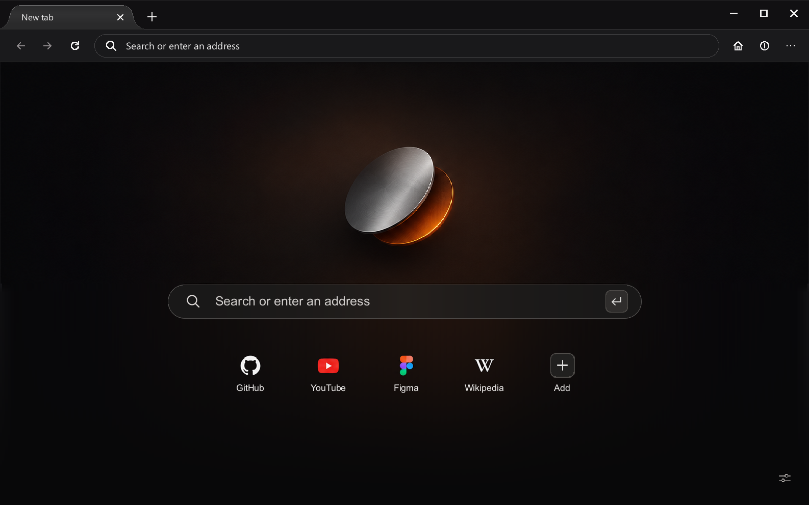

<p align="center"></p>
<h1 align="center">Satin</h1>

<p align="center"><strong>A web browser in Rust designed for speed and low memory use.</strong></p>
<p align="center">Open source · Windows x64 · Alpha</p>
<p align="center">
  <a href="https://github.com/Ferigone/satin/releases"><strong>Download for Windows</strong></a> ·
  <a href="#build-from-source">Build from source</a> ·
  <a href="docs/ROADMAP.md">Roadmap</a>
</p>

<p align="center"></p>

## About Satin

Satin brings tabs, browsing history, zoom, and a persistent profile to a desktop browser with its own web engine. The engine handles HTML, CSS, layout, rendering, the DOM, and JavaScript.

| Explore | Available in the alpha |
| --- | --- |
| Browse | HTTP and HTTPS pages, tabs, history, and zoom |
| Interact | Links, forms, JavaScript events, and DOM updates |
| Render | Text and images, CSS Flexbox and Grid, SVG, and Canvas 2D |
| Play media | Progressive and segmented H.264/AAC MP4 playback on Windows |

Website compatibility is partial. YouTube and Twitch playback remains in development.

## Install on Windows

1. Download `Satin-windows-x64.zip`. [GitHub Releases](https://github.com/Ferigone/satin/releases)
2. Extract the archive and run `Install.cmd`.
3. Open **Satin** from the desktop.

Satin checks for newer releases in the background. It verifies the downloaded update and uses it the next time you open the browser.

## Try the built-in pages

Enter an address below in Satin.

| Address | What to try |
| --- | --- |
| `about:home` | Open the start page and choose a demo |
| `about:media` | Play, pause, or seek within an MP4 sample |
| `about:streaming` | Play separate audio and video segments as they arrive |
| `about:javascript` | Run a script and interact with the page |
| `about:graphics` | Explore layout, SVG, and scrolling |
| `about:canvas` | Draw on a canvas and inspect the result |
| `about:version` | See browser features and known gaps |

## Build from source

On Windows x64, install the pinned Rust MSVC toolchain, Visual Studio C++ Build Tools, and the Windows SDK. From the repository root, run

```powershell
.\scripts\Build.ps1 -Release -Test
.\scripts\Install.ps1 -SkipBuild
```

Open the browser from the desktop shortcut after installation.

<details>
<summary>Developer resources</summary>

Run `.\scripts\Preview.ps1 -CreateShortcut` to add a **Satin Preview** desktop shortcut. It builds the current checkout when opened and uses a separate profile.

| Crate | Responsibility |
| --- | --- |
| [`browser`](crates/browser) | Desktop UI, profiles, and navigation |
| [`engine`](crates/engine) | Loading, HTML, DOM, CSS, layout, and painting |
| [`javascript`](crates/javascript) | JavaScript parser, compiler, and VM |
| [`js-harness`](crates/js-harness) | JavaScript compatibility tests |
| [`launcher`](crates/launcher) | Starts the active installed version |

Run `cargo test --workspace --locked` for the Rust test suite. [Verification](docs/VERIFICATION.md)

</details>

## License

Available under the MIT license or Apache License 2.0. Third-party materials retain their own licenses. [MIT](LICENSE-MIT) · [Apache 2.0](LICENSE-APACHE)
