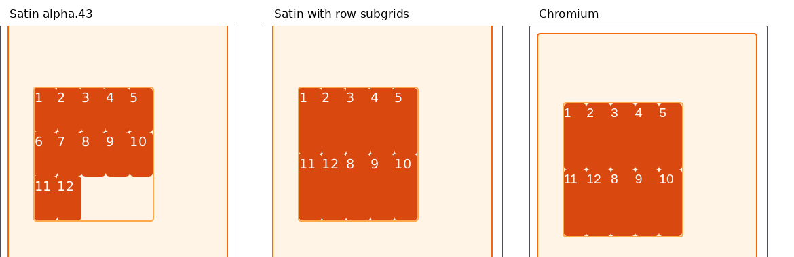
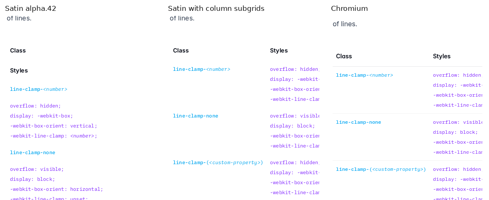
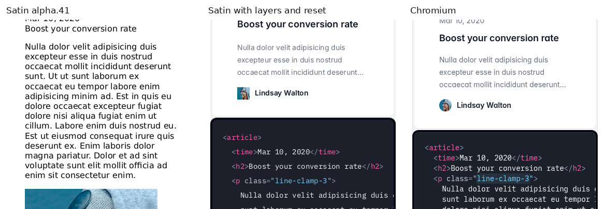

# CSS compatibility measurements

The alpha.35–alpha.36 audit ran on Linux x86_64 on 2026-11-25, against Satin `57e1dbd` (alpha.35) and [the CSS implementation released in alpha.36](https://github.com/Ferigone/satin/commit/8f8882f3d68d8eaaf8112194dac75f7ca61658c6). Both runs used Rust 1.99.1, the same system fonts and the same source pages. The candidate workspace test suite on Linux recorded 1,403 passes, zero failures and three pre-existing opt-in checks. The upstream [WPT revision is pinned to `9b8b1be`](https://github.com/web-platform-tests/wpt/tree/9b8b1beec730060783726b7c538b21e25e63b1f4/css).

## Row subgrid development

MDN's [implicit-track subgrid example](https://mdn.github.io/css-examples/grid/subgrid/no-implicit.html) places twelve children in five columns and two shared rows. The extra children overlap the last row. The column-only engine placed them in a third row. At both 390 × 800 and 1280 × 800 the first cell’s height changed from 65.33 to 98 CSS px, and the last cell’s top moved from y = 245.67 to 213 px. Chromium measured 98 and 213 px. At 390 px its first cell starts at x = 50.656 px, compared with 50.667 px in Satin. The same window was resized and scrolled in both directions. [Native screenshots and rectangles](css-row-subgrid-native.zip)



The tests change parent tracks and the subgrid’s own gutter while checking computed style, element rectangles and painted pixels. In a second test the two automatic parent rows contain children with different heights. Increasing the first child's height by 15 px moves the second child down by 15 px without distributing the extra size over both rows. [Regression tests](../../crates/engine/tests/css_row_subgrid.rs)

The screen comparison on the same 6,536 pairs changed from 1,993 to 1,998 passes (30.57%). There were 4,407 failures, 130 single-color inconclusive results, 1 renderer work limit, zero process timeouts and 19,782 entries outside this cohort. 7 gained a pass and 2 lost one. The separate linked-Ahem run changed from 316 to 317 passes in 1,388 comparisons, with 1,061 failures, 10 inconclusive results, zero errors and zero timeouts. All 87 relational selector assertions passed. [Every screen and Ahem status](css-row-subgrid-reftests.tsv.gz)

On the original `grid-gap-larger-001.html`, the nonuniform test image now matches the same reference that was checked in Chromium. The independent auto-row measurement also preserves the scroller’s wrapping under 60 px of horizontal padding in `subgrid-scroller-auto-height-padding.html`. Two experimental row grid-lanes gap cases now produce different images in both Satin and Chromium 156. All four measured reference rectangles in each of those cases match Chromium, up from two. The vertical named-line case uses `subgrid [a][][]` and `writing-mode:vertical-rl`. Its test and reference match within each browser, but none of the 60 reference rectangles agree between Satin and Chromium. This case is counted as a passing WPT relation while its writing-mode and named-line behavior remain unverified. [Per-element reference checks](css-row-subgrid-native.zip)

The full Linux workspace passed 1,472 tests with three existing opt-in tests ignored. The original synchronous WPT suite runs against 8,316 page entries: 3,472 complete, 269 partial, 223 harness errors, zero timeouts and 4,352 exclusions. It recorded 10,592 passes, 26,586 failures and one precondition failure. Nine previously failing assertions passed and one previous pass failed. On `subgrid-baseline-005.html`, item 6 with `align-self: last baseline` now starts at 308 px; the original assertion requires 360 px. The previous build placed both items 5 and 6 at 360 px. The row-subgrid build places both at 308 px: item 5 now passes but item 6 requires independent last-baseline alignment. These counts describe the row implementation before the baseline alignment change. [Per-assertion outcomes](css-row-subgrid-testharness.tsv.gz)

The next implementation tracks line baselines during layout and accounts for each baseline-sharing group when sizing and positioning grid items. The targeted original `subgrid-baseline-005.html` now passes the first six assertions, including item 6. Two assertions about alignment with items outside the nested subgrid still fail, and the harness stops at its work limit before the remaining four. A reduced test checks both shared-baseline positions after a live class change. The full benchmark for this follow-up is running. [Alignment implementation](https://github.com/Ferigone/satin/commit/d7b9cd3)

## Column subgrid development

On the Tailwind documentation page, the table, its section and each row are nested grids. At 390 × 800, alpha.42 stacked the two header cells and measured the row at 96 px tall. Sharing the parent columns puts the cells on one 48 px row, as in Chromium. The example paragraph farther down starts at y = 1,243.20 px, compared with 1,451.20 px in alpha.42 and 1,230.88 px in Chromium. At 1280 × 800 these y coordinates are 1,139.05, 1,347.05 and 1,126.88 respectively. All three preserve the paragraph’s height of 72 px at both widths. The narrow header columns measure 232.0 and 361.6 px in this build, compared with 241.19 and 334.81 px in Chromium. [Measured column implementation](https://github.com/Ferigone/satin/commit/8d33753) · [Screenshots, rectangles and WPT reference checks](css-subgrid-native.zip)



The regression changes the parent track definition, changes the viewport width without reloading, and checks both pixels and calculated rectangles. It reads the resolved subgrid line list and exercises a gutter larger than its tracks. [Regression tests](../../crates/engine/tests/css_column_subgrid.rs)

Three static comparisons expose missing features on the **test** side. The reference rectangles on all three now agree with Chromium for the measured elements. On the two grid-lanes cases Chromium 156 also reports no support for `display: grid-lanes` and its test and reference screenshots differ. The remaining `grid-gap-larger-001.html` uses a row and column subgrid simultaneously. Chromium matches its reference there. Alpha.42 obtained identical pixels on these three pairs while laying out the references differently from Chromium. [Oversized gutter fix](https://github.com/Ferigone/satin/commit/3f93a62)

Across the same 6,536 eligible screen comparisons, passes rose from 1,981 to 1,993 (30.49%). Fourteen failures and one inconclusive pair became passes. Three prior passes became failures and five single-color comparisons became visible mismatches. The final counts are 4,412 failures, 130 inconclusive pairs, one engine work limit, zero process timeouts and 19,782 exclusions. The supplemental Ahem cohort gained one pass with no losses, reaching 316 passes, 1,062 failures and ten inconclusive results among 1,388 comparisons. The property inventory still has 94 exact results among 625 distinguishing controls, and all 87 pinned selector assertions pass. [All pixel results, references and exclusions](css-subgrid-reftests.tsv.gz)

The original CSS testharness suite recorded 10,584 passing assertions, 26,594 failures and 1 precondition failure. Compared with alpha.42, 10 matching assertions changed from fail to pass and zero previous passes were lost. The runner did not reach 1 previously failing assertion(s). Among 8,316 pages, 3,472 completed, 269 were partial, 223 had a harness error, zero timed out and 4,352 were excluded. [Individual assertion outcomes](css-subgrid-testharness.tsv.gz)

The complete Linux workspace run for this candidate passed 1,470 tests, with three existing opt-in tests ignored. Blob URL fetches use zero-delay timer tasks. Their tests now drive pending tasks through a frame yield before comparing all six request outcomes.

On a separate wide-window check of the original Brave Search results, Chromium placed the sidebar under `#mixed-side` at x = 823 px. Satin left it under `#mixed-main` at x = 103 px. A second load in the versioned alpha.42 binary recorded three executed scripts, 30 skipped resources, zero pending requests, and a dynamic import ending with `ExecutionLimit: Native work budget exhausted`. The DOM and runtime observations do not isolate which module moves the sidebar. [Brave result page](https://search.brave.com/search?q=test)

## Author cascade layers on Tailwind CSS

The Tailwind CSS documentation applies its component utilities inside five `@layer` blocks. Alpha.41 fetched the stylesheet but discarded those blocks. The example paragraph used the default font, wrapped to 14 lines at 390 × 800 and occupied 268.8 px. The cascade-layer implementation applies the three-line limit, the Inter font stack and the requested 24 px line height. The paragraph measures 72 px at both viewport sizes. [Original Tailwind example](https://tailwindcss.com/docs/line-clamp) · [Measured implementation](https://github.com/Ferigone/satin/commit/f1ff062)

| Viewport, 1× scale | Alpha.41 paragraph (width × height) | With layers | With layers and reset | Chromium |
| --- | ---: | ---: | ---: | ---: |
| 390 × 800 | 294 × 268.8 | 158 × 72 | 254 × 72 | 254 × 72 |
| 1280 × 800 | 1,184 × 76.8 | 384 × 72 | 320 × 72 | 320 × 72 |



The reset groups the universal selector with `::backdrop`. Satin previously rejected this selector list, which kept the figure’s 40 px default margins, the body’s 8 px margins and content-box sizing. Accepting the valid pseudo-element restores the reset on ordinary elements. The paragraph now has exactly the Chromium x coordinate and width at both sizes. Its initial y coordinate still differs by 220.33 px on the narrow page and 220.17 px on desktop. [Selector fix and regression](https://github.com/Ferigone/satin/commit/b8fb946)

The same native window was resized without navigation. Scrolling brought the paragraph into view and returning to the top restored its original geometry. The archive includes the computed styles, full native captures and source hashes. [Download measurements and screenshots](css-layers-native.zip)

On the pinned WPT revision, `css/css-cascade/layer-basic.html` improved from 5/34 to 34/34, and `layer-important.html` from 1/9 to 9/9. Both original harnesses completed. Across the original 6,536 eligible static comparisons all 1,981 passes, 4,418 failures, 136 inconclusive results and the one work-limit error remained the same. The 19,782 other screen entries remained outside that cohort. The regression checks named layers across stylesheets, conditional declarations, a custom property, inline importance, class changes, viewport resize and painted pixels. [Layer regression tests](../../crates/engine/tests/css_layers.rs)

The final selector change preserved every status in both pixel cohorts, including all 315 passes among the 1,388 supplemental Ahem comparisons. All 87 relational selector assertions and 1,466 Linux workspace tests passed, with three existing opt-in tests ignored. On Brave Search the one-line title retained its alpha.41 geometry and scroll behavior at both widths.

One remaining Tailwind difference is visible above the example. At 390 px, its table header uses a nested column subgrid. Chromium places the two cells side by side in one 48 px row. Satin stacks them in a 96 px row. Layered imports, layered font-face precedence, `revert-layer` and the specialized CSSOM layer interfaces also remain open.

### Synchronous WPT comparison for layers

| Outcome | Alpha.41 | Layers and reset |
| --- | ---: | ---: |
| Reported assertions passing | 10,523 / 37,180 (28.30%) | 10,574 / 37,180 (28.44%) |
| Pages marked COMPLETE | 3,472 | 3,472 |
| Pages marked PARTIAL | 269 | 269 |
| Pages marked HARNESS_ERROR | 223 | 223 |
| Pages marked NOT_RUN | 4,352 | 4,352 |
| Assertions marked FAIL | 26,656 | 26,605 |
| Assertions marked PASS | 10,523 | 10,574 |
| Assertions marked PRECONDITION_FAILED | 1 | 1 |
| Runner timeouts within harness errors | 0 | 0 |

51 matched assertions changed from FAIL to PASS and 0 changed from PASS to FAIL. 0 prior passes were unobserved in the candidate. [Individual WPT results](css-layers-testharness.tsv.gz)

## Alpha.41 line clamping

At 390 × 800 CSS px, Satin wrapped the first Brave Search result title onto a second line. The page requested a one-line preview. Alpha.41 measures the line, reserves space for the ellipsis, and stops emitting text and inline hit regions beyond it. The description moves up by 26 px. At 1280 × 800 the title already fit, and all three browsers measured it at 648 × 26 px. The screenshots below show the same result in alpha.40, alpha.41 and Chromium, left to right.


| Element and viewport | Alpha.40 rectangle (x, y, width, height) | Alpha.41 | Chromium 156.0.8078.79 |
| --- | --- | --- | --- |
| Brave result, 390 × 800 | 16, 622.18, 358, 52 | 16, 622.18, 358, 26 | 16, 625, 358, 26 |
| Brave result, 1280 × 800 | 127, 594.18, 648, 26 | 127, 594.18, 648, 26 | 127, 569, 648, 26 |
| MDN paragraph, 300 px wide, controlled font | 0, 16, 300, 120 | 0, 16, 300, 60 | 0, 16, 300, 60 |

The Linux native-window comparison used a 1× display and 100% zoom. The Brave query was `test`, and the selector was `.search-snippet-title`. The linked 1,259,798-byte stylesheet sets `display: -webkit-box`, `-webkit-box-orient: vertical`, and `-webkit-line-clamp: 1`. Both engines used the page’s Inter Variable family and a computed line height of 26 px. The alpha.40 CSSOM returned an empty clamp value and `block`. The candidate returned `1` and `flow-root`. The same native tab was resized and scrolled down and back up. The title kept its clamped height. The original page and a replay of identical server HTML, stylesheet and font bytes were checked separately. [Brave results](https://search.brave.com/search?q=test)

On the original MDN Playground example, the paragraph height dropped from 115.2 to 57.6 px in Satin. Chromium measured 54 px using its default font and line height. A replay fixed both engines to DejaVu Sans at 16 px with a 20 px line height. Both viewport widths then gave the rectangles above. The regression also changes a custom property and the element class in place, checks the following block, and resizes without reloading. A pixel test checks the visible ellipsis, a trailing break and an absolutely positioned child after the cutoff. [MDN example](https://developer.mozilla.org/en-US/docs/Web/CSS/Reference/Properties/line-clamp#truncating_a_paragraph_with_the_legacy_property) · [Regression tests](../../crates/engine/tests/css_line_clamp.rs)

The wide Brave page still differs. Its server HTML places the information card under `#mixed-main`. In the live native windows Satin retained that parent at x = 103, while Chromium moved the card under `#mixed-side` at x = 823 after script execution. The title’s vertical offset also still differs by 25.18 px on desktop. This release covers inline text in vertical legacy boxes. Nested block clamping, the unprefixed shorthand, custom ellipsis strings and vertical writing remain open.

### Pixel and CSSOM measurements

The before/after runs used Rust 1.99.1 on one Linux x86_64 host and the pinned WPT checkout and manifest under **Reproduce**. The original 26,318 screen entries had identical test and reference paths in both runs. Every alpha.40 status also matched the archived alpha.37 status. [Measured alpha.40 commit](https://github.com/Ferigone/satin/commit/f37b33a5f9b5f93b849418ea0899eb88dc86259c) · [Measured candidate engine](https://github.com/Ferigone/satin/commit/4ebaf760fd136017262a0a21284e76a00ac798bb)

| Screen comparison outcome | Original cohort, alpha.40 | Original cohort, alpha.41 | Additional linked-Ahem cohort, each build |
| --- | ---: | ---: | ---: |
| Eligible comparisons | 6,536 | 6,536 | 1,388 |
| Satisfied pixel relation | 1,968 (30.11%) | 1,981 (30.31%) | 315 (22.69%) |
| Failed pixel relation | 4,431 | 4,418 | 1,063 |
| Identical single-color canvases | 136 | 136 | 10 |
| Engine work limit | 1 | 1 | 0 |
| Process errors or timeouts | 0 | 0 | 0 |
| Outside this cohort | 19,782 | 19,782 | 24,930 |

All 1,968 prior passes held. Twelve new passes are in the line-clamp directory, which now has 36 passes, 221 failures and two inconclusive results in the original cohort. A separate float containment reference also passed with the new flow-root formatting context. The additional cohort changed no statuses. Across both cohorts, 18,394 screen entries still require other resources, document formats, scripting, interactions or configuration. [All screen outcomes with paths and references](css-reftest-alpha41.tsv.gz)

Run the optional cohort with the same command under **Reproduce**, adding `--ahem-only` and writing a separate report. Use the alpha.41 Python adapter and renderer example on both engine revisions. The adapter verifies the SHA-256 hashes of the canonical WPT font and stylesheet, decodes the font with Satin, and checks that two 20 px Ahem X glyphs paint an exact 40 × 20 green rectangle on the white canvas. It checks eligibility on each reference as well as the test.

All 823 property probes ran. Of 625 distinguishing computed values, exact matches rose from 92 to 94, missing readbacks fell from 532 to 530, and one serialization still differed. Five reference inputs had no distinguishing change and 193 had no reference sample. The six pinned relational-selector pages again passed all 87 assertions on both revisions. [Property inputs and readbacks for both builds](css-properties-alpha41.tsv.gz)

The candidate passed 1,464 workspace tests with three existing opt-in tests ignored. The complete Linux run used `RUST_TEST_THREADS=1 cargo test --workspace --locked`. The locked workspace build also succeeded. The pull request records the separate Windows verification and the original synchronous WPT assertion comparison. [Alpha.41 verification](https://github.com/Ferigone/satin/pull/24)

#### Synchronous CSS testharness

The runner inventoried 8,316 entries. The individual records preserve partial pages and assertions observed in only one revision.

| Outcome | Alpha.40 | Alpha.41 |
| --- | ---: | ---: |
| Reported assertions passing | 10,511 / 37,179 (28.27%) | 10,523 / 37,180 (28.30%) |
| Pages marked COMPLETE | 3,472 | 3,472 |
| Pages marked PARTIAL | 269 | 269 |
| Pages marked HARNESS_ERROR | 223 | 223 |
| Pages marked NOT_RUN | 4,352 | 4,352 |
| Runner timeouts within harness errors | 0 | 0 |
| Assertions marked FAIL | 26,667 | 26,656 |
| Assertions marked PASS | 10,511 | 10,523 |
| Assertions marked PRECONDITION_FAILED | 1 | 1 |

12 matched assertions changed from FAIL to PASS and 0 changed from PASS to FAIL. 0 previous passes were unobserved in the candidate. [Page and assertion statuses](css-js-alpha41.tsv.gz)

#### Property-parsing directory

The runner inventoried 1,325 entries. The individual records preserve partial pages and assertions observed in only one revision.

| Outcome | Alpha.40 | Alpha.41 |
| --- | ---: | ---: |
| Reported assertions passing | 6,086 / 15,943 (38.17%) | 6,088 / 15,944 (38.18%) |
| Pages marked COMPLETE | 1,112 | 1,112 |
| Pages marked PARTIAL | 21 | 21 |
| Pages marked HARNESS_ERROR | 0 | 0 |
| Pages marked NOT_RUN | 192 | 192 |
| Runner timeouts within harness errors | 0 | 0 |
| Assertions marked FAIL | 9,857 | 9,856 |
| Assertions marked PASS | 6,086 | 6,088 |

2 matched assertions changed from FAIL to PASS and 0 changed from PASS to FAIL. 0 previous passes were unobserved in the candidate. [Page and assertion statuses](css-parsing-alpha41.tsv.gz)

[Download native and Chromium screenshots, per-element geometry, scroll observations and source hashes (ZIP)](css-alpha41-native.zip)

## Alpha.37 static CSS rerun

On 2026-11-25 the alpha.37 renderer completed six Grid comparisons that had reached the engine work limit in alpha.36. The orthogonal writing-mode subgrid case matched its reference. The other five produced pixel differences. All 1,967 previous passes held and one work-limit error remains.

| Static screen result | Alpha.36 | Alpha.37 |
| --- | ---: | ---: |
| Pixel relation satisfied | 1,967 | 1,968 |
| Pixel relation failed | 4,426 | 4,431 |
| Identical single-color canvases | 136 | 136 |
| Renderer or work-limit error | 7 | 1 |
| Outside the static adapter | 19,782 | 19,782 |

Both measurements used the same Linux host, fonts, 800 × 600 viewport and pinned WPT manifest. All 26,318 entries had the same test paths and references. The six changes raise the pass rate from 30.09% to 30.11% across 6,536 eligible comparisons. The remaining sections preserve the alpha.35–alpha.36 measurements.

To reproduce the alpha.37 run, use the pixel-renderer steps under [Reproduce](#reproduce) at the [measured candidate commit](https://github.com/Ferigone/satin/commit/7d5477a24b8876a5ee24ad717a5ffce6a541d8bd). To reconstruct all alpha.37 statuses, read the `candidate` column of the [alpha.36 archive](css-reftest-outcomes.tsv.gz), then replace the six statuses identified by test path with the `after` values in the [machine-readable delta](css-reftest-alpha37-delta.json). It records the measured revisions, tree, viewport and manifest checksum. The alpha.36 renderer source matches the [alpha.36 release commit](https://github.com/Ferigone/satin/commit/f437b715d3d370c2d57164136f58fc0f996527ef).

## Alpha.35 and alpha.36 rendering

The WPT manifest lists 40,145 test entries in `css/`. It contains 26,318 screen reftests, 8,316 JavaScript testharness entries, 1,236 crash tests, 1,150 manual tests, 415 print reftests and 2,710 visual tests. The screen comparison ran every entry eligible under the static HTML filters, 6,536 test/reference comparisons. The remaining test types have independent execution requirements.

| Outcome | Alpha.35 | Alpha.36 |
| --- | ---: | ---: |
| Pixel relation satisfied | 1,726 | 1,967 |
| Pixel relation failed | 4,626 | 4,426 |
| Identical single-color canvases | 177 | 136 |
| Renderer or work-limit error | 7 | 7 |
| Outside this adapter | 19,782 | 19,782 |

The engine rendered both pages at 800 × 600. The runner checks the pixel buffer against each specified reference, including inequality references. A matched pair can still mask a feature missing on both sides. Identical single-color pages are recorded separately. For example, both pages in `css/css-masking/clip-path/clip-path-inset-round-percent.html` paint a full pink square in Satin, while Chromium paints only its clipped bottom edge. The static adapter excludes scripts, XML/XHTML documents, external resources, font dependencies, testdriver, clocks and fuzzy comparisons. An error on either page gives an error for that comparison. A fresh page has no browsing history or simulated user interaction. The full per-test table includes paths, references, exclusions and both outcomes. [Download outcomes (TSV.GZ)](css-reftest-outcomes.tsv.gz)

280 previous failures now pass. 52 previous passes now fail. A control build containing the named-color change alone reproduces 45 of those losses. For example, `row-rule: 10px solid gold` on `css/css-gaps/flex/flex-gap-decorations-025.html` still lacks a painted gap rule, while its reference can now draw gold. The other seven comparisons expose the following gaps. The test and reference rendered the same way on the baseline. The candidate renders a visible difference. These focused checks varied one part of the case while retaining the upstream reference.

| WPT case | Observed difference |
| --- | --- |
| `css-break/flexbox/multi-line-row-flex-fragmentation-049.html` | Flex items wrap across an unfragmented container. Giving the flex container the expected 50 px column width produces the reference image. |
| `css-flexbox/balance/balance-002.html` and `balance-003.html` | The unsupported balanced-wrap values produce the same image as `nowrap`. Forcing two items per line with regular or reverse wrapping reproduces the references. |
| `css-writing-modes/direction-upright-002.html` | Upright text leaves the RTL direction active in vertical flex containers. Setting the direction of those containers to LTR reproduces the reference. |
| `css-conditional/container-queries/chrome-legacy-skip-recalc.html` | The feature query now correctly hides the PASS label because the engine lacks `container-type: inline-size`. |
| `css-color/color-mix-currentcolor-nested-for-color-property.html` | The text inherits blue. Replacing the nested mix with the expected `color(srgb .5 .75 .75)` reproduces the reference. |
| `css-color/hsl-009.html` | The engine paints extreme HSL input white. Substituting the extended-range sRGB equivalent given in the test reproduces the reference. |

## Individual properties and targeted regressions

The property inventory runs one edit on a connected HTML element for every one of the 823 names in W3C Webref 8.7.10. It checks specified values, priority, malformed overwrites, removal, and the live computed value. The chosen input changed the computed value in Chromium 158.0.8127.0 for 625 names. Five samples had no distinguishing change and 193 lacked a reference sample. For each of those 198 cases the report retains the available observations. [Property results (CSV)](css-properties.csv) · [Inputs and reproduction](../../tools/css-properties/README.md)

- The number of changed computed values whose final string matches Chromium increased from **79 to 92 of 625**. The other comparable probes produced 532 empty values and one differently rounded transform matrix. Inline editing and serialization matched on 160 names. Three more were editable with a different serialized value.
- Six pinned relational-selector pages passed **1 of 87** synchronous WPT subtests before and **87 of 87** after, including sibling and descendant relations, specificity and query scope. The adapter validates each upstream file hash and subtest count.
- **19 of 63** Flexbox rectangles matched Chromium 131.0.6778.0 before and **63 of 63** after. The regression covers 23 layouts, 252 coordinates, a 0.05 CSS pixel tolerance, row/column wrapping, reversed axes, gaps and automatic margins.
- **29 of 148** absolute color names painted the reference sRGB value before and **148 of 148** after. The test used the uppercase spelling of each keyword and a separate hexadecimal control. The regression fixture contains all 148 reference values. The five upstream `css/css-color/hwb-00[1-5].html` image comparisons now pass.
- Absolute `oklab()`, `oklch()`, `color(srgb …)`, `color(srgb-linear …)`, `color(display-p3 …)` and `color(display-p3-linear …)` paint into Satin’s 8-bit sRGB canvas. In the 44 related WPT reftests the count rose from **4 to 38 passes**, with five mismatches and one exclusion. Reporting a computed color still serializes the converted RGB value.
- A page can query `CSS.supports(property, value)` or a condition string. Stylesheet `@supports` evaluates the same condition. Four pinned WPT files recorded 49/49 passing feature-query subtests. Direct edits using either `element.style.flexWrap` or `element.style["flex-wrap"]` change the declaration, and the original `flex-wrap-computed.html` moved from 0/3 to 3/3.

### Follow-up on regressing assertions

The candidate rejects a trailing decimal point in `flex-grow: 1.` and preserves the last valid declaration. Percentage heights in a column flex container now use a definite percentage basis when available. Horizontal `left` and `right` alignment work in RTL rows, fieldsets distribute their flex contents through the anonymous content box, and reverse-axis overflow contributes to scroll dimensions and signed scroll offsets.

On the pinned WPT negative-overflow-002 page, all 24 horizontal cases passed when run individually with the upstream layout assertions, including both initially regressing cases. Each case uses the same CSS, DOM and expected geometry as the full page. This isolates them from the script work limit on the 72-case document. Six of seven groups passed when the percentage-heights-003 groups ran individually. The remaining group uses vertical writing. The original full-page results, including incomplete runs, are recorded below.

## JavaScript WPT assertions

The runner classified all 8,316 WPT `css/` testharness entries. It started 3,964 synchronous HTML documents using the original WPT harness, helpers and assertions in a fresh Satin page runtime. Original resources were loaded from the pinned checkout. The reporting hook records declared results, diagnostics and harness completion. Unsupported variants, non-HTML documents, asynchronous fixtures and missing infrastructure are marked separately. A partially executed or errored page can emit subtest results before stopping. [Per-page and per-subtest outcomes (TSV.GZ)](css-testharness-outcomes.tsv.gz)

| Measure | Alpha.35 | Alpha.36 |
| --- | ---: | ---: |
| Pages with a completed harness | 3,473 | 3,472 |
| Pages with partial results | 265 | 269 |
| Pages with a harness error | 226 | 223 |
| Entries outside this adapter | 4,352 | 4,352 |
| Reported subtests · FAIL | 28,794 | 26,668 |
| Reported subtests · PASS | 9,330 | 10,514 |
| Reported subtests · PRECONDITION_FAILED | 0 | 1 |

Matching the assertion name within each WPT document, **1,186 failures changed to passes** and **10 passes changed to failures**. The two builds reached different numbers of assertions on some partial pages. All ten newly failing assertions occur in the vertical or sideways writing-mode cases of `negative-overflow-003.html` and `negative-overflow-004-no-padding.html`. The baseline also laid these cases out horizontally. All observed statuses and missing observations are preserved in the per-subtest table.

Of the candidate's passes, 5,912 test names are recognized invalid-value probes. Rejecting a bad value can pass even for an unimplemented property. On fully completed pages alone the harness recorded 9,021 passes and 21,616 assertion failures.

The narrower recursive `css/**/parsing/**/*.html` probe is another view of the verified inputs. It found 1,325 documents. Reported passing assertions changed from 5,578 to 6,086, with 9,857 failures on the candidate. Among same-named parsing assertions, 508 changed from fail to pass and zero changed from pass to fail. The candidate passes 446 of the recognized computed-value assertions in this subset, up from zero. The per-property breakdown counts the positive, negative and computed-value WPT probes for each identifiable CSS property. [Parsing subtests by property (CSV)](css-parsing-properties.csv)

These checks overlap the broader measurement. The focused six-page selector run also overlaps WPT inputs. Keep the denominators separate.

```sh
cargo build --locked -p rust-browser-engine --example css_parsing_wpt
python3 tools/css-parsing-wpt.py wpt target/debug/examples/css_parsing_wpt css-js.json --manifest wpt-manifest.json --any-sync
python3 tools/css-parsing-wpt.py wpt target/debug/examples/css_parsing_wpt css-parsing.json
```


## WPT inventory and screen comparisons by directory

All directories with CSS test entries are listed. The first two counts give the full WPT inventory and the number of screen reftests. The baseline column counts successful screen comparisons on alpha.35. The remaining columns refer to alpha.36.

| Directory | All WPT | Screen reftests | Baseline passes | Pass | Fail | Single color | Error | Skipped |
| --- | ---: | ---: | ---: | ---: | ---: | ---: | ---: | ---: |
| compositing | 89 | 60 | 2 | 2 | 17 | 0 | 0 | 41 |
| css-align | 312 | 66 | 6 | 7 | 27 | 0 | 0 | 32 |
| css-anchor-position | 557 | 241 | 4 | 4 | 75 | 0 | 0 | 162 |
| css-animations | 281 | 37 | 0 | 0 | 0 | 0 | 0 | 37 |
| css-backgrounds | 709 | 593 | 24 | 25 | 39 | 11 | 0 | 518 |
| css-borders | 607 | 382 | 27 | 27 | 33 | 2 | 0 | 320 |
| css-box | 95 | 42 | 0 | 0 | 13 | 0 | 0 | 29 |
| css-break | 1386 | 1145 | 37 | 34 | 198 | 0 | 0 | 913 |
| css-cascade | 169 | 45 | 8 | 8 | 4 | 1 | 0 | 32 |
| css-color | 396 | 321 | 78 | 119 | 114 | 0 | 0 | 88 |
| css-color-adjust | 41 | 24 | 1 | 1 | 3 | 0 | 0 | 20 |
| css-color-hdr | 4 | 0 | 0 | 0 | 0 | 0 | 0 | 0 |
| css-conditional | 474 | 173 | 13 | 36 | 28 | 1 | 0 | 108 |
| css-contain | 606 | 438 | 50 | 50 | 110 | 4 | 0 | 274 |
| css-content | 84 | 66 | 3 | 3 | 33 | 3 | 0 | 27 |
| css-counter-styles | 276 | 260 | 2 | 2 | 180 | 1 | 0 | 77 |
| css-device-adapt | 7 | 0 | 0 | 0 | 0 | 0 | 0 | 0 |
| css-display | 363 | 225 | 11 | 11 | 27 | 0 | 0 | 187 |
| css-easing | 15 | 0 | 0 | 0 | 0 | 0 | 0 | 0 |
| css-env | 13 | 0 | 0 | 0 | 0 | 0 | 0 | 0 |
| css-exclusions | 12 | 4 | 0 | 0 | 0 | 0 | 0 | 4 |
| css-flexbox | 1485 | 1025 | 172 | 298 | 212 | 11 | 0 | 504 |
| css-font-loading | 36 | 7 | 0 | 0 | 0 | 0 | 0 | 7 |
| css-fonts | 581 | 386 | 11 | 11 | 16 | 0 | 0 | 359 |
| css-forced-color-adjust | 4 | 0 | 0 | 0 | 0 | 0 | 0 | 0 |
| css-forms | 26 | 16 | 2 | 2 | 10 | 0 | 0 | 4 |
| css-gaps | 651 | 553 | 53 | 20 | 477 | 3 | 0 | 53 |
| css-gcpm | 20 | 0 | 0 | 0 | 0 | 0 | 0 | 0 |
| css-grid | 2612 | 1786 | 270 | 267 | 759 | 12 | 7 | 741 |
| css-highlight-api | 141 | 111 | 0 | 0 | 0 | 0 | 0 | 111 |
| css-image-animation | 23 | 22 | 0 | 0 | 0 | 0 | 0 | 22 |
| css-images | 545 | 490 | 11 | 11 | 25 | 32 | 0 | 422 |
| css-inline | 453 | 383 | 2 | 2 | 6 | 0 | 0 | 375 |
| css-layout-api | 154 | 135 | 0 | 0 | 1 | 0 | 0 | 134 |
| css-link-params | 9 | 0 | 0 | 0 | 0 | 0 | 0 | 0 |
| css-lists | 258 | 201 | 22 | 22 | 107 | 10 | 0 | 62 |
| css-logical | 92 | 6 | 5 | 5 | 0 | 0 | 0 | 1 |
| css-masking | 592 | 514 | 13 | 14 | 64 | 0 | 0 | 436 |
| css-mixins | 66 | 0 | 0 | 0 | 0 | 0 | 0 | 0 |
| css-motion-path | 1 | 0 | 0 | 0 | 0 | 0 | 0 | 0 |
| css-multicol | 733 | 464 | 40 | 41 | 58 | 0 | 0 | 365 |
| css-namespaces | 24 | 23 | 0 | 0 | 0 | 0 | 0 | 23 |
| css-navigation | 26 | 3 | 0 | 0 | 0 | 0 | 0 | 3 |
| css-nesting | 47 | 17 | 4 | 5 | 7 | 0 | 0 | 5 |
| css-overflow | 1047 | 738 | 88 | 89 | 308 | 8 | 0 | 333 |
| css-overscroll-behavior | 12 | 0 | 0 | 0 | 0 | 0 | 0 | 0 |
| css-page | 283 | 0 | 0 | 0 | 0 | 0 | 0 | 0 |
| css-paint-api | 119 | 115 | 0 | 0 | 0 | 0 | 0 | 115 |
| css-painting | 1 | 1 | 1 | 1 | 0 | 0 | 0 | 0 |
| css-parser-api | 1 | 0 | 0 | 0 | 0 | 0 | 0 | 0 |
| css-position | 405 | 252 | 16 | 17 | 35 | 2 | 0 | 198 |
| css-properties-values-api | 126 | 7 | 0 | 0 | 5 | 1 | 0 | 1 |
| css-pseudo | 376 | 280 | 24 | 24 | 51 | 0 | 0 | 205 |
| css-rhythm | 35 | 18 | 1 | 1 | 9 | 0 | 0 | 8 |
| css-round-display | 15 | 0 | 0 | 0 | 0 | 0 | 0 | 0 |
| css-ruby | 184 | 143 | 16 | 16 | 51 | 0 | 0 | 76 |
| css-scroll-anchoring | 86 | 4 | 0 | 0 | 0 | 0 | 0 | 4 |
| css-scroll-snap | 227 | 26 | 1 | 1 | 6 | 0 | 0 | 19 |
| css-scrollbars | 57 | 31 | 2 | 2 | 6 | 1 | 0 | 22 |
| css-shadow | 209 | 114 | 0 | 0 | 34 | 1 | 0 | 79 |
| css-shapes | 396 | 242 | 6 | 8 | 66 | 0 | 0 | 168 |
| css-size-adjust | 5 | 0 | 0 | 0 | 0 | 0 | 0 | 0 |
| css-sizing | 881 | 612 | 31 | 31 | 102 | 0 | 0 | 479 |
| css-speech | 11 | 0 | 0 | 0 | 0 | 0 | 0 | 0 |
| css-style-attr | 16 | 16 | 0 | 0 | 0 | 0 | 0 | 16 |
| css-syntax | 52 | 1 | 0 | 0 | 0 | 0 | 0 | 1 |
| css-tables | 363 | 172 | 36 | 36 | 43 | 7 | 0 | 86 |
| css-text | 2096 | 1644 | 108 | 108 | 280 | 0 | 0 | 1256 |
| css-text-decor | 475 | 339 | 57 | 57 | 128 | 5 | 0 | 149 |
| css-transforms | 943 | 797 | 124 | 139 | 140 | 1 | 0 | 517 |
| css-transitions | 202 | 6 | 0 | 0 | 0 | 0 | 0 | 6 |
| css-typed-om | 412 | 5 | 0 | 0 | 0 | 0 | 0 | 5 |
| css-ui | 1320 | 965 | 27 | 27 | 21 | 1 | 0 | 916 |
| css-values | 539 | 222 | 42 | 42 | 52 | 10 | 0 | 118 |
| css-variables | 252 | 183 | 65 | 125 | 36 | 0 | 0 | 22 |
| css-view-transitions | 561 | 341 | 2 | 2 | 0 | 0 | 0 | 339 |
| css-viewport | 155 | 113 | 8 | 8 | 72 | 3 | 0 | 30 |
| css-will-change | 53 | 47 | 3 | 3 | 33 | 0 | 0 | 11 |
| css-writing-modes | 1405 | 1171 | 39 | 38 | 73 | 1 | 0 | 1059 |
| css-zoom | 1 | 0 | 0 | 0 | 0 | 0 | 0 | 0 |
| CSS1 | 1 | 0 | 0 | 0 | 0 | 0 | 0 | 0 |
| CSS2 | 9267 | 6245 | 100 | 100 | 72 | 0 | 0 | 6073 |
| cssom | 305 | 12 | 0 | 0 | 0 | 0 | 0 | 12 |
| cssom-view | 254 | 11 | 0 | 0 | 0 | 0 | 0 | 11 |
| fetching | 1 | 0 | 0 | 0 | 0 | 0 | 0 | 0 |
| fill-stroke | 11 | 1 | 0 | 0 | 0 | 0 | 0 | 1 |
| filter-effects | 437 | 375 | 43 | 42 | 39 | 1 | 0 | 293 |
| geometry | 31 | 0 | 0 | 0 | 0 | 0 | 0 | 0 |
| mediaqueries | 99 | 58 | 0 | 0 | 3 | 0 | 0 | 55 |
| motion | 151 | 101 | 0 | 0 | 54 | 0 | 0 | 47 |
| printing | 39 | 1 | 0 | 0 | 0 | 0 | 0 | 1 |
| reference | 3 | 3 | 0 | 0 | 1 | 0 | 0 | 2 |
| selectors | 850 | 344 | 15 | 23 | 63 | 3 | 0 | 255 |
| WOFF2 | 300 | 298 | 0 | 0 | 0 | 0 | 0 | 298 |

## Reproduce

Use Python 3.11 or later, Rust from the repository toolchain and a local WPT checkout. The default runner is diagnostic and writes a status for every screen reftest. Fonts and platform can affect text-dependent comparisons. For direct before/after comparisons keep the host and upstream inputs constant.

```sh
git -c core.autocrlf=false clone --filter=blob:none --no-checkout https://github.com/web-platform-tests/wpt.git wpt
git -C wpt sparse-checkout set css resources
git -C wpt checkout 9b8b1beec730060783726b7c538b21e25e63b1f4
curl -fL --compressed 'https://wpt.fyi/api/manifest?sha=9b8b1beec730060783726b7c538b21e25e63b1f4' -o wpt-manifest.json
cargo build --locked -p rust-browser-engine --example css_reftest_render
python3 tools/css-wpt.py wpt wpt-manifest.json target/debug/examples/css_reftest_render css-reftests.json
cargo run --locked -p rust-browser-engine --example css_property_inventory > css-properties.jsonl
cargo run --locked -p rust-browser-engine --example css_relational_wpt -- wpt
cargo test --locked -p rust-browser-engine --tests --no-fail-fast
```

The pixel runner checks the Git blob ID of each selected page against manifest version 9. The SHA-256 of the complete manifest for this snapshot is `9ac259ce07a43bd66304fc6c8a73277afebeff1418cced979fe8d280c247fd28`. A different manifest can change both the cases and the denominator.
